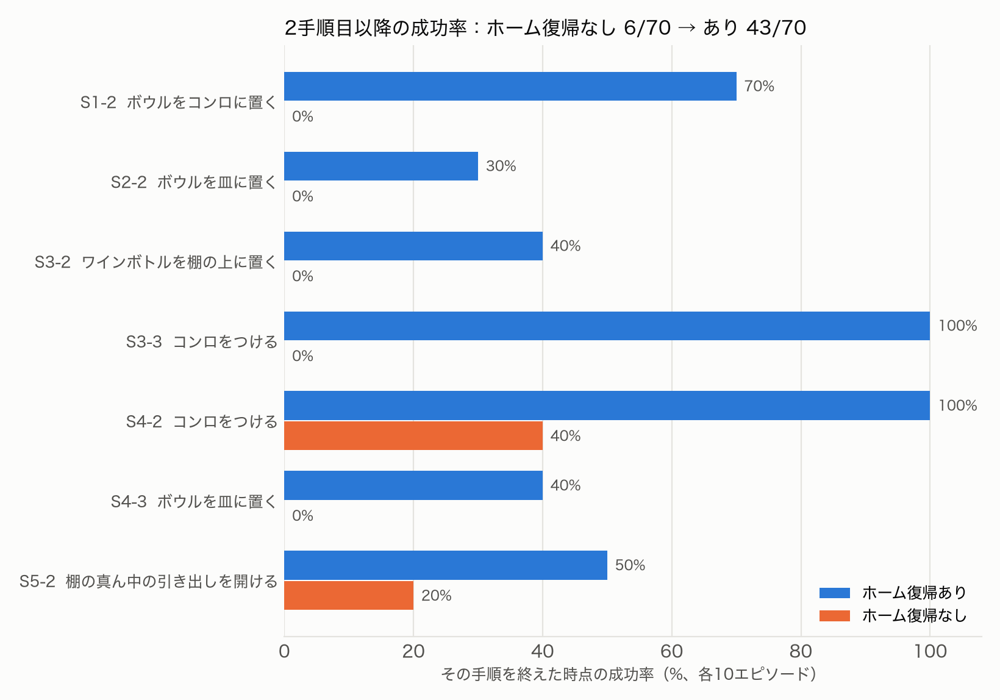

# 段取りロボット：単一タスク用のVLAに、日本語の複数手順の指示をこなさせる

Physical AI 応用編1 最終課題　説明資料

- 動画：https://youtu.be/MfEJrppipX4 （2分43秒。1:29〜2:07は2倍速）
- コード：https://github.com/myouga312/dandori-robot

## 1. 概要と目的

SmolVLAのような単一タスク用のVLAは、「コンロをつける」のような1つの指示なら高い成功率で実行できる。
しかし「料理の準備をして」のような、**複数の手順が要るあいまいな日本語の指示**には対応できない。
本課題では、**VLAを追加学習せずに**、次の三層で複数の手順を続けて実行させるシステムを作り、シミュレーションで評価した。

| 層 | 役割 | 実装 |
|---|---|---|
| Planner | 日本語の指示を、VLAが学習したスキルの列に分解する。実行できない依頼は断る | Claude（`claude-opus-5-5`）。JSON Schemaの `enum` で、スキル一覧の外の手順を出せないようにした |
| Executor | 1手順ずつ閉ループで実行する。リセットはせず、シーンを引き継ぐ | `HuggingFaceVLA/smolvla_libero`（公開の重み）。50手を予測して10手を実行 |
| Verifier | 実行前後の画像から達成を判定し、停止・再試行・再計画を決める | Claude（画像入力・構造化出力） |

シミュレータにはLIBERO-Goalを使った。1つの台所シーンに10のゴールタスクがある。

## 2. 工夫した点

1. **リセットせずにゴールだけを差し替える**：LIBERO-Goalの10タスクは同じシーンを共有している（起動時に検査）。
   物理状態はそのままにして、BDDLのゴール条件だけを入れ替える。こうすると、手順ごとにシミュレータの正解判定を評価に使える。
2. **関節空間のホーム復帰**：手順をつなぐと、前の手順を終えたアームの姿勢が学習時の開始姿勢とずれ、次の手順が失敗する（分布のずれ）。
   手先の位置と向きを戻すだけ（OSC）では、肘が張り出した構えから抜け出せず、0.3 mずれたまま止まることがあった。
   そこで、**ホーム復帰のあいだだけコントローラを関節位置制御に切り替え**、7つの関節を初期値に戻すようにした。
   切り替える前には、置いた物を払わないよう、手を開いて真上に逃がす。
3. **止めた後の猶予ステップ**：達成した瞬間に止めると、物を手放す前にアームが止まり、置いた物が倒れる。そこで、止めると決めた後も25ステップだけVLAを動かす。
4. **Verifierによる止め時の判断と立て直し**：VLAには終わりを判断する仕組みがない。そこで100ステップごとに画像で判定して止める。
   失敗と判定したら、同じ手順を再試行し、それでも駄目なら現在のシーン画像と失敗理由を渡して再計画する。
5. **APIを使わないLLMの呼び出し**：所属組織の制約でClaude APIを使えなかった。そこでClaude Codeの非対話モード（`claude -p`）を最小構成で起動し、
   GPUのVMからGCSを介して手元の端末に中継した。VMには認証情報を一切置いていない。
   最小構成（システムプロンプト差し替え、設定・MCP・ツールを読まない）にすることで、1回の消費を約55,000トークンから約2,800トークンまで削った。
6. 公開モデルの既定値（50手をまとめて実行）では成功率が約20ポイント落ちるという報告がある。そのため、10手ごとに予測し直す設定にした。

## 3. 評価

条件：各シナリオ10エピソード。成否はシミュレータの正解判定で数え、最後の時点で全目標が成立しているかを見る。

### 3.1 単一スキル

10タスク×10エピソードで77/100。公開値（約81%）と同程度だった。

### 3.2 連続実行

| シナリオ | 手順 | 単純につなぐ | ＋ホーム復帰 | ＋Verifier（システム全体） |
|---|---|---|---|---|
| S1 | コンロ → ボウルをコンロへ | 0/10 | 7/10 | **9/10** |
| S2 | チーズをボウルへ → ボウルを皿へ | 0/10 | 0/10 | 1/10 |
| S3 | 引き出し → ワインを棚の上へ → コンロ | 0/10 | 1/10 | 1/10 |
| S4 | ワインを棚の上へ → コンロ → ボウルを皿へ | 0/10 | 1/10 | **7/10** |
| S5 | ワインを棚の上へ → 引き出し | 1/10 | 5/10 | 5/10 |
| 計 | | 1/50 | 14/50 | **23/50** |

- 「単純につなぐ」と「＋ホーム復帰」は、正しい計画を与え、正解判定で止めた場合（Executorの上限）。
- **2手順目以降の成功率**は、ホーム復帰によって **6/70（9%）→ 43/70（61%）** に上がった（図1）。
- システム全体では、Plannerは50回すべてで参照どおりの計画を出した。再試行60回のうち14回で成功を取り戻し、再計画は24回だった。

### 3.3 Verifierの判定精度

各手順の最終判定191件で、シミュレータの正解と比べた正解率は**92.7%**だった。誤りの内訳は、未達成を達成と判定したものが10件、達成を見逃したものが4件。
途中判定を含む全551件の呼び出しでは93.8%だった。

**GPT-6との比較（部分的）**：保存した判定データを、GPT-6（Codex CLI）に同じ条件で判定させた。
クレジットの上限により、比較できたのは最初の131件だけだった。内訳はS1・S2が中心で、96件が「ボウルを皿に置く」。
この131件では、両者の判定は**完全に一致**した（ともに正解率99.2%、誤判定はどちらも同じ1件）。
比較できた範囲は判定しやすい事例に偏っている可能性があり、難しい事例での差は検証できていない。

### 3.4 Plannerの振る舞い

- 「冷蔵庫から牛乳を出して」：使えるスキルがないとして、計画を空にして断った。
- 「お茶の準備をして」：ボウルの用意だけを計画した。「水も容器もないのにコンロをつけると空焚きになる」として、**安全のためにコンロをつけないことを自分で選んだ**。

## 4. 考察と限界

- **分布のずれの主な原因は、開始時のアームの姿勢だった。** 単体なら10/10の「コンロをつける」も、つなぐと0〜4/10に落ちる。関節角まで戻せば10/10に戻る。
- **残る失敗**は、前の手順が次の手順の前提を変える組み合わせで起きる。S2では中身の入ったボウルを運び、S3では開いた引き出しのそばでワインを扱う。
  VLAが学習したのは「きれいな初期配置からの1動作」だけなので、組み合わせによって生じた状態は学習の範囲外になる。
- Verifierが未達成を達成と誤判定すると、失敗したまま次の手順へ進んでしまう（10/191件）。
- 限界：シミュレーションのみで、スキルはLIBERO-Goalの10種類に限られる。各シナリオ10エピソードなので、数ポイント程度の差はばらつきの範囲。

## 5. 実用性と今後

倉庫や家庭で、「片付けておいて」といった粗い指示をロボットに任せる場面を想定している。単体スキルのVLAを作り直さず、上に計画と検証の層を足すだけで、手順の組み合わせに対応できる。
今後の課題は次のとおり。

- 手順の相性（順序で成否が変わる）を考慮した計画
- 組み合わせによって生じた状態から、データを集めて再学習する
- 実機（SO-101など）への展開

## 6. 使用したもの

LIBERO（MIT）、LeRobot（Apache-2.0）、SmolVLA（`HuggingFaceVLA/smolvla_libero`）、Claude（Claude Code経由）、GPT-6（Codex CLI経由、比較用）。
